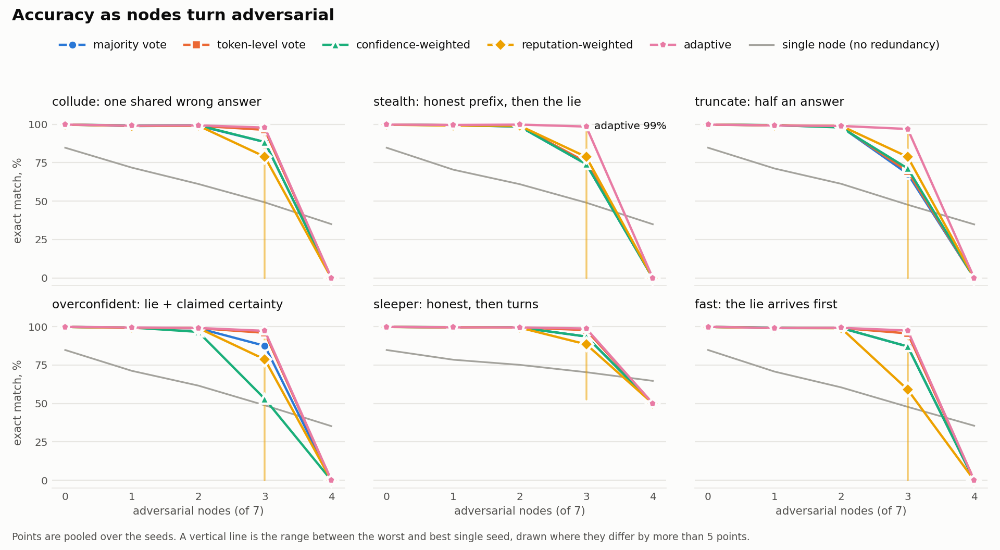
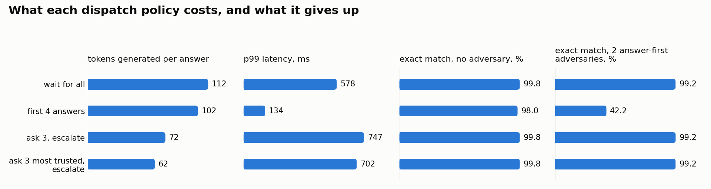

# The cluster layer — distributed inference, aggregation, robustness

When the same prompt goes to several replicas of a model and some of them are
wrong — because they are lossy, faulty, slow, or actively lying — how should
the answers be combined, and what does that cost?

`cluster/` is a framework for answering that question, and an answer for one
setting. It has two halves:

1. **A distributed inference system** — inference nodes, an orchestrator that
   fans requests out and collects the answers, logging of every response and
   of system metrics, and a pipeline that turns those logs into labelled
   datasets under normal and adversarial conditions.
2. **An aggregation and robustness framework** — eleven ways of combining
   node outputs, detectors for inconsistent / outlying / adversarial
   responses and nodes, evaluation metrics, and a sweep that compares it all
   under eleven attacks.



The short version of the results, for 7 nodes (5,000 requests per cell):

- Redundancy pays before any adversary shows up: one node answers 84.8% of
  requests exactly right, any vote over seven gets 99.8%.
- With up to 2 adversarial nodes, every strategy that always answers and does
  not trust self-reported confidence stays at or above 97.8% under every
  attack. The choice barely matters — unless it trusts confidence, which an
  adversary simply sets.
- At 3 of 7 the strategies separate. Majority voting falls to 67.8% in the
  worst case; classic reputation weighting gets *captured* outright on some
  runs; the `adaptive` strategy holds 97.2% in its worst case.
- At 4 of 7 everything is at 0%. No aggregation survives an adversarial
  majority, and nothing here pretends otherwise.

Everything below is reproducible from a seed: `go run ./cmd/robusteval`
regenerates [`bench/robustness/report.md`](../bench/robustness/report.md), the
full tables these numbers come from.

## Map

| Package | What it is |
|---|---|
| [`cluster`](../cluster) | wire types (`Request`, `Response`, `Decision`), dispatch `Policy`, sequence and robust-statistics helpers |
| [`cluster/node`](../cluster/node) | an inference node: backends, fault injection, HTTP server and client |
| [`cluster/orchestrator`](../cluster/orchestrator) | membership, health probing, fan-out under a dispatch policy, HTTP API |
| [`cluster/record`](../cluster/record) | JSONL request log and system-metrics sampler |
| [`cluster/dataset`](../cluster/dataset) | scenarios, dataset generation, preprocessing into feature tables |
| [`cluster/aggregate`](../cluster/aggregate) | aggregation strategies |
| [`cluster/detect`](../cluster/detect) | per-request anomaly flags; cross-request trust, drift and collusion tracking |
| [`cluster/eval`](../cluster/eval) | metrics, the scenario sweep, the report |

| Binary | What it does |
|---|---|
| `cmd/node` | run one node (synthetic model, or in front of a `kllm serve`) with an optional fault profile |
| `cmd/orchestrator` | run the coordinator |
| `cmd/datagen` | generate labelled datasets, one scenario or the whole suite |
| `cmd/robusteval` | run the sweep, or score an existing request log |
| `cmd/serve` | the engine itself — it speaks the node protocol natively |

No dependencies beyond the Go standard library, like the rest of the repo.

---

# Part 1 — the distributed system

## Nodes

A node turns a prompt into tokens and reports, per token, the probability its
model put on it. Three kinds:

- **The engine.** `kllm serve` answers `POST /v1/infer` natively, so a GPU
  process is a cluster node with no wrapper. Its confidences are the softmax
  probability of each greedy token (`Scheduler.SubmitConf`).
- **A front for the engine.** `cmd/node --upstream URL` forwards to any
  node-protocol server and can apply a fault profile on the way out — the real
  model, misbehaving on purpose.
- **A synthetic model** (`node.Sim`), for experiments that need thousands of
  labelled requests and no GPU. It is a deterministic autoregressive model
  with a known ground truth (its greedy decode). A replica with lossiness
  `Noise` errs the way a quantized replica of a real model does: by taking
  the runner-up token at a *low-margin* decode step, and then continuing from
  the diverged context. Two replicas therefore tend to make the same mistake
  on the same prompt, which is what makes voting non-trivial. `Corr` makes
  that error fully common-mode, the case no vote can fix.

The protocol is one JSON request and one JSON response:

```
POST /v1/infer   {"id": "r1", "prompt": [1, 17, 42], "max_new_tokens": 16}
             ->  {"request_id": "r1", "node": "n3", "tokens": [...], "conf": [...], "latency_ms": 97.2}
GET  /healthz    /stats.json    /metrics (Prometheus)
```

A node runs in **real time** (it waits out its latency, honours deadlines,
sheds load past `--max-concurrent`) or in **virtual time** (it answers
immediately and *reports* the latency). Virtual time is what lets the lab
generate a 34-scenario suite (300 requests each) in about seven seconds, and
it makes datasets exactly reproducible.

## Fault profiles

`node.Inject` wraps any backend. Adversaries in the standard suite are
*omniscient*: they run a noiseless replica, so they know the right answer and
deviate from it on purpose.

| Profile | What the node does | What it is aimed at |
|---|---|---|
| `crash` | every request errors | availability; wait-for-all latency |
| `straggler` | honest answer, 400 ms late | tail latency |
| `random` | random tokens | the weakest possible vote |
| `perturb` | a token or two substituted | detectors that look for *big* differences |
| `truncate` | the first half of the right answer | prefix-based voting — a truncated answer is a correct prefix |
| `collude` | all members emit one shared wrong answer | whole-answer voting |
| `stealth` | colluders keep an honest 75% prefix, then lie | similarity-based detection and prefix voting |
| `overconfident` | collude + report 0.999 confidence | confidence weighting |
| `intermittent` | collude on a shared 30% of prompts | per-node reputation: each looks 70% honest |
| `sleeper` | honest for the first half of the run, then collude | learned trust |
| `fast` | collude, answering in 2 ms | first-k dispatch |

Every response carries a lab-only `label` (`fault`, `attacked`) so datasets can
be scored. Aggregators and detectors are always handed `cluster.Blind`
copies; a test checks they never see a label.

## Orchestrator

The orchestrator keeps a membership (static via `--nodes`, or nodes announce
themselves with `cmd/node --register`), probes health, and runs each request
under a dispatch policy:

| Policy | Behaviour | Buys | Risks |
|---|---|---|---|
| `all` | ask everyone, wait for everyone (or the timeout) | the most evidence | latency is the slowest node's |
| `first-k` | proceed at K answers, cancel the rest | tail latency | whoever answers first decides |
| `adaptive` | ask 3, escalate by 2 only while they disagree | compute | a unanimous panel is believed |

The semantics live in one place, `cluster.Policy`. The orchestrator executes
them live; `Policy.Replay` applies them to a recorded wait-for-all run. That
is what lets one dataset be scored under every policy, and a test checks the
live path and the replay pick the same nodes.

```
POST   /v1/infer     {prompt, max_new_tokens} -> {tokens, share, margin, suspects, latency_ms, queried}
                     (?verbose=1 returns every node's response)
GET    /nodes        membership, health, load, trust
POST   /nodes        {id, url}            DELETE /nodes/{id}
GET    /healthz      /stats.json          /metrics
```

## Logging and data collection

Two append-only JSON Lines files, written by `cmd/orchestrator --log
--metrics-log` on a live cluster and by `cmd/datagen` in the lab:

```jsonc
// requests.jsonl — one line per request
{"time": "2026-01-01T00:00:00.143Z", "scenario": "collude-f2", "seq": 0,
 "request": {"id": "collude-f2-000000", "prompt": [402, 188, ...], "max_new_tokens": 16},
 "reference": [497, 474, ...],                        // ground truth, when the run has one
 "responses": [{"node": "n00", "tokens": [...], "conf": [...], "latency_ms": 87.9,
                "label": {"fault": "collude", "attacked": true}}, ...],
 "decision": {...}, "policy": "all", "latency_ms": 143.3, "queried": 7, "rounds": 1}

// metrics.jsonl — every node's counters, sampled
{"time": "...", "seq": 100, "nodes": [{"node": "n00", "requests": 100, "errors": 0,
  "tokens": 1600, "latency_mean_ms": 110.0, "latency_p99_ms": 500, "in_flight": 0, "heap_mb": 1.8}, ...]}
```

The reader fails on a malformed line rather than skipping it: a silently
shortened dataset is worse than a failed load.

## Datasets

A `dataset.Scenario` — seed, workload shape, groups of nodes each with a
lossiness and an optional fault profile — fully determines a dataset. The same
scenario reproduces the same `requests.jsonl` byte for byte.

```powershell
go run ./cmd/datagen --attack normal --out data/normal
go run ./cmd/datagen --attack collude --adversaries 2 --out data/collude-f2
go run ./cmd/datagen --suite --out data/suite        # normal + every attack x adversary count
```

Each scenario directory holds the raw logs plus the preprocessed tables:

| File | Contents |
|---|---|
| `scenario.json`, `manifest.json` | what was run; the answer key and per-fault summary |
| `requests.jsonl`, `metrics.jsonl` | raw logs, as above |
| `features.csv`, `train.csv`, `test.csv` | one row per node response; the split holds out whole requests |
| `node_metrics.csv` | cumulative counters differenced into per-interval rows |

The feature columns are restricted to what an orchestrator can actually
observe — `mean_sim` (edit similarity to the other answers), `agree_frac`,
`in_plurality`, `plurality_lcp`, `mean_conf`, `min_conf`, `latency_z` (robust
z-score among peers), `answers`, `distinct`, `top_share`, `entropy` — followed
by the labels `fault`, `attacked`, `correct`, `ref_sim`.

## Running a live cluster

This is the configuration the layer was verified with on the lab GPU: two real
engine processes (fp32 and W4), three node processes in front of the fp32
engine — one of them lying — and the orchestrator.

```powershell
go run ./cmd/serve --addr 127.0.0.1:8177 --node-id gpu-fp32
go run ./cmd/serve --addr 127.0.0.1:8178 --node-id gpu-w4 --model testmodels/tiny-llama-w4
go run ./cmd/node --id replica-a --addr 127.0.0.1:9101 --upstream http://127.0.0.1:8177
go run ./cmd/node --id replica-b --addr 127.0.0.1:9102 --upstream http://127.0.0.1:8177
go run ./cmd/node --id liar --addr 127.0.0.1:9103 --upstream http://127.0.0.1:8177 --fault collude --register http://127.0.0.1:9100
go run ./cmd/orchestrator --addr 127.0.0.1:9100 --aggregator adaptive --log data/live/requests.jsonl --metrics-log data/live/metrics.jsonl --nodes "gpu-fp32=http://127.0.0.1:8177,gpu-w4=http://127.0.0.1:8178,replica-a=http://127.0.0.1:9101,replica-b=http://127.0.0.1:9102"
```

```powershell
curl.exe -s -X POST http://127.0.0.1:9100/v1/infer -d '{\"prompt\":[1,17,42,100,7],\"max_new_tokens\":16}'
```

In that run the cluster returned exactly the engine's own greedy decode on all
62 requests sent and named `liar` as a suspect from the first one. It also
distrusted `gpu-w4` (trust 0.06): on the tiny *random-weight* test checkpoint
the W4 replica matched fp32 exactly on only 2 of 62 requests (4.6 of 16 tokens
of shared prefix on average), because that model's logits are nearly flat and
quantization flips the argmax constantly. That says something about the test
checkpoint, not about W4 on a trained model — which has not been measured
here.

Without a GPU, drop `--upstream` and the nodes run the synthetic model.

---

# Part 2 — aggregation and robustness

## Strategies

All implement `cluster.Aggregator` and see only tokens, self-reported
confidences and latencies. Decisions never depend on arrival order.

| Family | Strategy | Idea |
|---|---|---|
| baseline | `single` | one node's answer: what no redundancy gets you |
| voting | `majority` | the most common whole answer wins |
| | `quorum` | majority, but abstain unless more than half of *all* nodes back it |
| token-level | `token-vote` | vote token by token among answers consistent with the prefix chosen so far |
| ranking | `mbr` | the answer most similar to all the others (minimum Bayes risk) |
| | `borda` | rank aggregation: each node ranks the distinct answers by similarity to its own |
| confidence | `confidence` | votes weighted by reported confidence |
| | `confidence-clipped` | the same, with no vote allowed above the median confidence |
| | `max-confidence` | the single most confident answer |
| adaptive | `reputation` | votes weighted by each node's learned record of agreeing |
| | `adaptive` | token-level vote + screening + bounded learned discounts + bloc collapsing |

`token-vote` is worth a sentence. Whole-answer voting wastes the votes of
honest nodes that diverged late and in different directions; voting token by
token lets them back the prefix they share. The walk always ends on an answer
some node actually gave — it never splices tokens from decodes that had
already diverged, which would be text no model generated.

## Detection

Nothing here knows the right answer; every signal is relative to the other
nodes.

**Per request** (`detect.Config.Inspect`), thresholds on robust z-scores
(median / MAD), so a minority of wild values cannot move the yardstick:

| Flag | Fires when |
|---|---|
| `failed` | error or timeout |
| `outlier` | mean similarity to peers is far below the others' |
| `minority` | disagrees with an answer most nodes gave |
| `overconfident` | reported confidence far above peers' |
| `fast` / `slow` | latency far from peers' and at least 2x away |
| `truncated` | under 75% of the median length |

**Across requests** (`detect.Tracker`):

- **Trust** — decayed, smoothed agreement with the adopted answer.
- **Drift** — a one-sided CUSUM on each node's disagreement against its own
  baseline. A sleeper waking trips it within ten to fifteen requests, long
  before its trust has decayed.
- **Collusion** — nodes that repeatedly deviate from consensus *with identical
  answers* form a bloc. This exposes intermittent colluders that each look
  like a 70%-accurate honest node on their own.

## Metrics

| Metric | Definition |
|---|---|
| exact match | the returned answer equals the reference; an abstention is not correct |
| token accuracy | fraction of the reference matched before the answer diverges |
| coverage / selective accuracy | fraction answered; exact match among the answered |
| attack success rate | of requests carrying a tampered answer, how often it was the one returned |
| worst case, breakdown point | lowest exact match over all attacks at f adversaries; smallest f taking it below 50% |
| best / worst seed | pooled figures hide runs that fail completely — see *capture* below |
| latency | mean, p50, p95, p99 until the policy had the answers it needed |
| efficiency | nodes asked, tokens generated per answer, tokens per correct answer |
| detection | precision / recall / F1 per response and per node; time to detect; honest nodes wrongly suspected |

Everything is computed by **replay** over wait-for-all recordings, so every
strategy and policy is scored on exactly the same node responses.

## Results

Setup: 7 nodes — honest replicas of mixed quality (lossiness 0.05 / 0.10 / 0.20,
single-node exact match 92% / 85% / 72%) and 0–4 omniscient adversaries;
16-token answers; 1,000 requests x 5 seeds per condition. A 95% interval on a
cell near 99% is about ±0.3 points; near 75%, ±1.2.

### Exact match, 3 of 7 nodes adversarial

| strategy | normal | collude | stealth | truncate | overconfident | sleeper | fast | intermittent | random | perturb | crash |
|---|--:|--:|--:|--:|--:|--:|--:|--:|--:|--:|--:|
| single | 84.8 | 49.2 | 49.0 | 47.7 | 48.8 | 70.3 | 47.8 | 78.1 | 48.3 | 48.5 | 85.6 |
| majority | 99.8 | 88.5 | 74.1 | 67.8 | 87.5 | 93.5 | 87.1 | 96.1 | 97.7 | 99.2 | 97.8 |
| quorum | 97.9 | 53.8 | 53.7 | 54.2 | 53.6 | 77.5 | 52.3 | 85.5 | 53.7 | 53.8 | 54.7 |
| token-vote | 99.9 | 96.4 | 75.4 | 69.4 | 96.0 | 97.8 | 95.6 | 98.5 | 97.7 | 98.2 | 97.7 |
| mbr | 99.8 | 91.5 | 74.2 | 68.6 | 91.0 | 95.5 | 90.6 | 97.4 | 97.7 | 99.9 | 97.8 |
| borda | 99.8 | 88.1 | 74.2 | 68.0 | 87.3 | 93.5 | 86.8 | 96.2 | 95.7 | 99.9 | 97.8 |
| confidence | 99.8 | 88.5 | 74.1 | 71.3 | 52.9 | 93.5 | 53.3 | 96.1 | 98.8 | 98.8 | 98.9 |
| confidence-clipped | 99.8 | 88.5 | 74.1 | 69.2 | 85.5 | 93.5 | 85.2 | 96.1 | 99.1 | 99.2 | 98.8 |
| max-confidence | 94.2 | 86.8 | 73.1 | 48.7 | 0.0 | 91.2 | 7.4 | 92.4 | 96.4 | 96.4 | 96.6 |
| reputation | 99.7 | 78.9 | 78.8 | 78.8 | 78.6 | 88.5 | 59.0 | 81.9 | 98.2 | 98.1 | 98.4 |
| **adaptive** | 99.8 | **97.9** | **98.3** | **97.8** | **97.2** | **98.8** | **97.4** | **99.3** | 97.7 | 98.4 | 98.4 |

### Worst case over all attacks

| strategy | clean | f=1 | f=2 | f=3 | f=4 |
|---|--:|--:|--:|--:|--:|
| single | 84.8 | 70.2 | 59.7 | 47.7 | 34.8 |
| majority | 99.8 | 98.9 | 98.3 | 67.8 | 0.0 |
| quorum | 97.9 | 91.5 | 81.3 | 52.3 | 0.0 |
| token-vote | 99.9 | 99.0 | 98.4 | 69.4 | 0.0 |
| mbr | 99.8 | 98.9 | 98.3 | 68.6 | 0.0 |
| borda | 99.8 | 98.8 | 97.8 | 68.0 | 0.0 |
| confidence | 99.8 | 99.3 | 96.6 | 52.9 | 0.0 |
| confidence-clipped | 99.8 | 99.3 | 98.5 | 69.2 | 0.0 |
| max-confidence | 94.2 | 0.0 | 0.0 | 0.0 | 0.0 |
| reputation | 99.7 | 99.0 | 98.9 | 59.0 | 0.0 |
| adaptive | 99.8 | 99.1 | 98.9 | 97.2 | 0.0 |

### What the numbers say

**1. The honest-majority margin is thinner than n/2.** Seven nodes with three
adversaries leaves four honest nodes, a majority — but majority voting needs
the honest nodes *that got it right* to outnumber the bloc, and honest nodes
that err split their votes. With 85%-accurate replicas, all four are right only
about half the time. That is why `majority` is at 88.5% under plain collusion
at f=3 while being fine at f=2.

**2. Token-level voting recovers that margin — against fabricated answers
only.** `token-vote` holds 96.4% under `collude`, because the honest nodes
pool on their shared prefix. Against an attack that is itself
prefix-consistent it gains nothing: 75.4% under `stealth`, 69.4% under
`truncate`. The cheapest attack in the suite — return half the right answer —
is the strongest one against every stateless strategy, because a truncated
answer is a correct prefix.

**3. Self-reported confidence is an attack surface.** On honest replicas it
is a real signal. Against adversaries, `confidence` drops to 52.9% the moment
they claim certainty, and `max-confidence` returns the lie on 100% of attacked
requests with a *single* adversary. Clipping every vote at the median reported
confidence restores it to 85.5% — about where majority voting is — at the
price of no longer letting a confident minority overrule an unsure majority.

**4. Abstaining converts wrong answers into visible failures.** `quorum`
returned a tampered answer on 0.0% of attacked requests at every adversary
count below a majority. The price is coverage: 53.8% of requests answered
under collusion at f=3, every one of them correct.

**5. Strategies that learn from their own decisions are bistable.** This is
the result that reshaped the design. `reputation` weights votes by how often
each node agreed with past decisions — and near the breaking point, whichever
side wins early is the side it learns to trust:

| strategy | attack (f=3) | pooled | worst seed | best seed |
|---|---|--:|--:|--:|
| reputation | collude | 78.9 | 0.0 | 98.8 |
| reputation | stealth | 78.8 | 0.0 | 98.8 |
| reputation | truncate | 78.8 | 0.0 | 98.7 |
| reputation | overconfident | 78.6 | 0.0 | 98.8 |
| reputation | fast | 59.0 | 0.0 | 98.8 |
| adaptive-naive | stealth | 79.3 | 1.5 | 99.0 |

A pooled 78.9% does not mean "somewhat worse". It means right on four runs
and **captured** on the fifth: 0% for a thousand requests, with every honest
node distrusted. The first version of `adaptive` (kept as the
`adaptive-naive` ablation) did the same under `stealth`. Three rules removed
the captured state:

- **Learn only from decisive requests** — those a strict majority of the
  answering nodes settled outright. A minority cannot manufacture one, so
  nothing it wins by a tie or a split ever becomes evidence.
- **Bounded influence** — with n voters, a learned discount leaves at least
  n/(n+1) of a vote: enough to settle equal head counts in favour of the
  better record, never enough to overturn a head-count majority.
- **Only minority blocs collapse** — a bloc of half the nodes or more is
  presumed to be the honest majority agreeing, and left alone.

**6. What each part of `adaptive` contributes** (exact match at f=3; the
bracket is the worst seed where it differs by more than 5 points):

| variant | truncate | collude | stealth | overconfident | intermittent | fast |
|---|--:|--:|--:|--:|--:|--:|
| token-vote (the base) | 69.4 | 96.4 | 75.4 | 96.0 | 98.5 | 95.6 |
| adaptive | 97.8 | 97.9 | 98.3 | 97.2 | 99.3 | 97.4 |
| − screening | 98.2 | 97.9 | 98.4 | 97.2 | 99.4 | 97.4 |
| − learned discount | 97.7 | 97.9 | 97.0 | 97.2 | 99.0 | 97.3 |
| − bloc collapsing | 97.8 | 97.7 | 91.5 | 97.1 | 98.1 | 97.3 |
| unbounded discounts | 97.8 | 97.9 | 98.7 | 97.2 | 99.3 | 97.4 |
| learn from everything (naive) | 97.8 | 97.9 | 79.3 [1.5] | 97.7 | 99.1 | 97.6 |

Read plainly: the defences overlap. For most attacks, removing any one of them
changes nothing because another covers it — `truncate` is handled equally
well by screening, by the learned discount, or by bloc collapsing. The
exception is `stealth`, where bloc collapsing carries the weight (91.5%
without it). **Per-request screening contributes nothing measurable on its
own in this suite** (within half a point everywhere). And once learning is
restricted to decisive requests, bounding the discounts changes no number
here: it is kept as a guarantee
(`TestLearnedDiscountCannotOverturnAMajority`), not because the sweep needed
it.

## Reliability against cost



| method | EM clean | p50 ms | p99 ms | nodes asked | tokens / answer | EM, 2 `fast` adversaries | EM, 3 sleepers | p99 ms, 2 stragglers |
|---|--:|--:|--:|--:|--:|--:|--:|--:|
| adaptive, wait for all | 99.8 | 143 | 578 | 7.00 | 112.0 | 99.2 | 98.8 | 895 |
| adaptive, first 4 | 98.0 | 101 | 134 | 7.00 | 102.4 | 42.2 | 84.0 | 170 |
| adaptive, ask 3 + escalate | 99.8 | 151 | 747 | 4.51 | 72.2 | 99.2 | 97.2 | 1425 |
| adaptive, ask 3 most trusted + escalate | 99.8 | 135 | 702 | 3.89 | 62.3 | 99.2 | 50.0 | 1030 |

- **first-k buys tail latency with integrity.** p99 falls from 578 ms to
  134 ms because a stalled node no longer holds the request. But the decision
  now belongs to whoever answers first, and an adversary can arrange to be
  first: two `fast` colluders are half of every 4-node quorum, and exact match
  falls from 99% to 37–42% whichever strategy does the voting. It saves little
  compute — 9% — since the cancelled nodes had mostly finished.
- **Escalation buys compute with latency.** Asking three and escalating only
  on disagreement generates 36% fewer tokens at the same accuracy, clean and
  with two adversaries, because replicas usually agree. It is slower when
  they do not (p99 747 ms, rounds are sequential), and much slower behind
  stragglers.
- **Asking the most trusted first is the cheapest policy and the easiest to
  defeat.** It asks 3.9 nodes on average. Sleepers earn exactly the trust it
  rewards; once they turn, they are the panel, they agree with each other,
  and no honest node is ever asked: 50.0% overall is 0% after they wake. A
  unanimous panel of k is only as trustworthy as the way its members were
  chosen — random selection bounds the chance of an all-adversary panel
  (1 in 35 with three of seven), selection by reputation hands the choice to
  the adversary. The orchestrator's default order is the random one.

## Detection results

Two adversaries of seven unless noted; "node" is the tracker's end-of-run
verdict against the nodes that actually tampered.

| attack | stateless recall | with memory: recall | precision | node P / R | requests to detect |
|---|--:|--:|--:|--:|--:|
| crash | 100.0 | 100.0 | 83.1 | 100 / 100 | 11.6 |
| random | 89.7 | 99.8 | 90.8 | 100 / 100 | 15.2 |
| truncate | 100.0 | 100.0 | 88.4 | 100 / 100 | 15.4 |
| collude | 88.4 | 99.9 | 90.0 | 100 / 100 | 13.2 |
| overconfident | 93.1 | 99.9 | 90.2 | 100 / 100 | 13.6 |
| fast | 92.5 | 99.9 | 90.3 | 100 / 100 | 13.4 |
| perturb | 2.2 | 98.7 | 83.4 | 100 / 100 | 14.0 |
| stealth | 0.0 | 98.6 | 83.4 | 100 / 100 | 14.4 |
| sleeper | 87.6 | 99.8 | 73.1 | 100 / 100 | 9.4 |
| intermittent | 87.5 | 99.7 | 57.5 | 100 / 100 | 27.8 |
| collude, f=3 | 0.1 | 97.3 | 97.3 | 100 / 100 | 26.2 |
| stealth, f=3 | 0.1 | 97.2 | 90.2 | 100 / 100 | 24.0 |

- **Node-level detection was exact, with one exception.** For every content
  attack with one to three adversaries, every adversarial node was identified
  and no honest node was under suspicion at the end of any of the 5 seeds
  (nor in the no-adversary runs). The exception is a *lone* intermittent
  adversary: lying on 30% of requests with no accomplice to deviate in step
  with, it is indistinguishable from a 70%-accurate honest replica and is
  never flagged (recall 0). It is also harmless to the vote — exact match
  stays above 99%.
- **The stateless detector fails in two predictable ways.** It cannot see
  attacks designed to look similar (`perturb` 2.2%, `stealth` 0.0%), and it
  stops working once adversaries are numerous: three of seven is not an
  outlier, so recall on `collude` drops from 88.4% to 0.1%. Memory restores
  both to 97% or better.
- **Response-level precision is lower by design.** It counts an adversary's
  *honest* answers as false positives once the node is a suspect — which is
  most of what a sleeper or an intermittent colluder sends.
- **Stragglers are never flagged as adversarial**, correctly: they are slow,
  not dishonest. `slow` is an operational flag.

## Limits

What these results do and do not establish:

- **The model is synthetic.** `node.Sim` is built to err the way lossy
  replicas of a real model do, but the absolute numbers are properties of it.
  The framework runs against the real engine (see *Running a live cluster*),
  and `robusteval --data` scores any request log that carries references; a
  sweep on real checkpoints has not been run.
- **Confidence carries signal by assumption.** `Sim.OffPath` makes a decode
  that has left the reference trajectory report 10% lower probabilities.
  Every result about confidence weighting on *honest* replicas rests on that
  knob. The results about spoofing do not.
- **Exact match is a strict metric**, appropriate for greedy decoding of one
  model, where a right answer is unique. It would undercount agreement
  between sampled or paraphrased outputs, where similarity-based strategies
  (`mbr`) would matter more than they do here.
- **Adversaries are omniscient but not adaptive.** They know the right answer;
  they do not know or react to the defence. An adversary that adds noise to
  its honest behaviour to dodge bloc detection, or that probes for which
  requests are decisive, is outside the suite.
- **One cluster shape.** Seven nodes, three honest quality levels, 16-token
  answers. The breakdown at f=4 is the general n/2 bound; where exactly each
  strategy starts to bend below it depends on how accurate the honest nodes
  are.
- **Detection thresholds are fixed defaults**, chosen on the hand-built cases
  in the tests and not tuned per attack.

## Reproducing

```powershell
go test ./cluster/...                              # ~20 s, no GPU needed
go run ./cmd/robusteval --seeds 5 --out bench/robustness   # the sweep: ~1 min
python tools/plot_robustness.py                    # the two figures
go run ./cmd/datagen --suite --out data/suite      # the datasets themselves
go run ./cmd/robusteval --data data/suite/stealth-f3/requests.jsonl   # score one log
```
